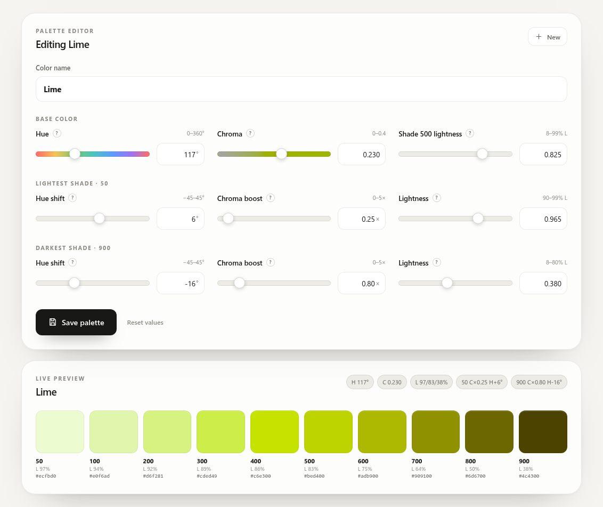
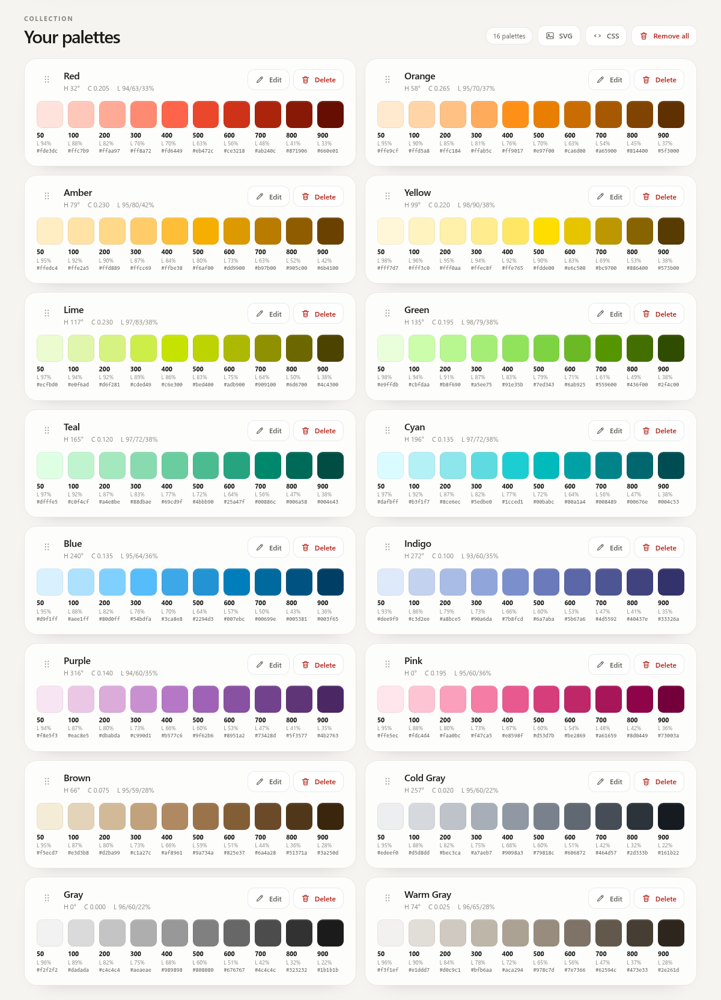

# idx Color Palette Generator

A browser-only color palette generator built around the OKLCH color model. Pick a hue, a base chroma and the lightness of shade 500, then tune the lightness, chroma boost and hue shift of the lightest and darkest ends to get a ten-step palette with a live preview.



## Features

- OKLCH-based palettes with sRGB gamut mapping.
- Live preview of shades 50–900, with copy-to-clipboard hex values.
- Adjustable hue, base chroma and shade-500 lightness.
- Separate lightness, chroma boost (0–5× the base chroma) and hue shift (−45°–45°) controls for shades 50 and 900.
- Shape-preserving interpolation carries lightness, chroma and hue smoothly between the base and endpoint anchors.
- Save, edit, delete, and drag-and-drop reorder palettes.
- Reset values restores a saved palette’s stored values while editing; new palettes reset to the editor defaults.
- Palettes persist in `localStorage`.
- The palette collection is also encoded in the page URL for sharing.
- Light and dark themes, with the selected theme persisted.
- Compact mobile layout: editor and preview fit small screens, and all shades stay on one line without horizontal scrolling.
- Ships with 16 OKLCH-tuned default palettes (Red through Warm Gray), restorable from the empty state.
- Export the whole collection as an SVG sheet or a CSS file, opened in a new tab.

## Default palettes

The collection starts with 16 OKLCH-tuned palettes: Red, Orange, Amber, Yellow, Lime, Green, Teal, Cyan, Blue, Indigo, Purple, Pink, Brown, Cold Gray, Gray and Warm Gray. Each one sets its own endpoint lightness, chroma boost and hue shift so the ramps keep their hue character as they approach white and black.



## Tech stack

- [React](https://react.dev/) and TypeScript
- [Vite](https://vite.dev/)
- [culori](https://culorijs.org/) for OKLCH → sRGB conversion
- [Vitest](https://vitest.dev/) for unit tests
- ESLint for linting

## Getting started

Requires Node.js 20.19+ or 22.12+.

```bash
npm install
npm run dev
```

Open the URL printed by Vite (usually `http://localhost:5173`).

## Scripts

| Command | Description |
| --- | --- |
| `npm run dev` | Start the Vite development server. |
| `npm run build` | Type-check and build the production bundle. |
| `npm run preview` | Preview the production build locally. |
| `npm run lint` | Run ESLint. |
| `npm run test` | Run the unit tests once. |
| `npm run typecheck` | Run the TypeScript compiler without emitting files. |

## Distribution

`npm run build` produces a single self-contained `dist/index.html` with the CSS, JavaScript, and favicon inlined. It can be:

- opened directly in a browser via `file://`, or
- copied to any web server and served from any URL path.

The page URL is kept in sync with the palette set on save, delete, and reorder, including when the app runs from `file://`. Opening a bookmarked URL restores that palette set.

## Usage

1. Enter a name for the palette.
2. Adjust Hue, Chroma and Shade 500 lightness, then shape the ends with the lightness, chroma boost and hue shift controls for shades 50 and 900.
3. Click any swatch to copy its hex value.
4. Save the palette to add it to the collection below.
5. When editing a saved palette, use **Reset values** to return the controls to the values stored before editing.
6. Edit, delete, or drag palettes to reorder them.
7. Use **SVG** or **CSS** in the collection header to open an export of all palettes in a new tab.

Sharing the current page URL carries the saved palette list to whoever opens the link. The URL payload is compact CSV (`hue,chroma,shade500,lightest,lightestChromaBoost,lightestHueShift,darkest,darkestChromaBoost,darkestHueShift,name`, one palette per line) encoded as URL-safe base64.

## Project structure

```text
src/
  App.tsx                 Application shell and palette actions
  components/             Editor, preview, list, dialogs, and controls
  lib/
    color.ts              OKLCH/gamut logic and swatch generation
    defaultPalettes.ts    Seeded built-in palettes
    palette.ts            Palette identity, validation, and ordering
    storage.ts            localStorage and URL persistence
  main.tsx                React entry point
  styles.css              Application styles, including responsive layout
  types.ts                Shared TypeScript types
reference/                Palette reference material
dist/                     Production build output
```

## Notes

- All data stays in the browser. There is no backend.
- Palettes are matched by trimmed, case-insensitive name; saving with an existing name updates it.
- Out-of-gamut colors lose chroma until they are displayable in sRGB, preserving hue and lightness.
- Older five-value CSV URLs, curve/gamma JSON payloads, and stored palettes from the previous model are migrated automatically.
